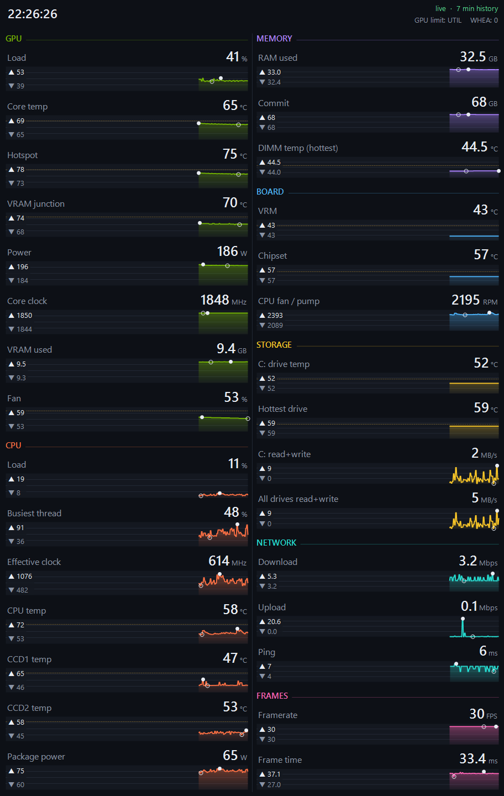

# PC Monitor Panel

A borderless, always-on-top desktop sensor panel for Windows, built for a **3440x1440 ultrawide**. It fills a strip on the right edge of that monitor with live numbers and history graphs for every sensor worth watching: GPU, CPU, memory, board, storage, network, and in-game framerate.

All data comes from [HWiNFO](https://www.hwinfo.com/) through its shared memory interface. Framerate and frametime come from [RivaTuner Statistics Server](https://www.guru3d.com/download/rtss-rivatuner-statistics-server-download/) through HWiNFO's built-in RTSS integration, so nothing draws inside your games.



## Features

* Borderless and always on top, a permanent fixture that never steals focus and stays out of Alt-Tab and the taskbar
* Two columns, each row showing the current value, a history graph, and the high and low for the visible window
* Peak (solid dot) and valley (hollow dot) markers on every graph
* Warning and critical colors with a dashed warning line on the graph
* History of 7 minutes (one pixel per second) or 1 hour (right-click to switch)
* Header with clock, NVIDIA GPU performance limiter (PWR, THERM, VREL, VOP, UTIL), and new WHEA hardware errors since launch
* Built-in ping graph
* Detects a stalled HWiNFO feed and says so instead of showing frozen numbers
* Rows with no matching sensor on your hardware hide themselves
* Everything is defined in `panel.json`: sensors, labels, thresholds, colors, columns, monitor, width
* Single 35 KB exe, no installer, no runtime to install (uses .NET Framework 4.x, which ships with Windows 10 and 11)

## Monitor layout

By default the panel looks for a monitor running at **3440x1440** and docks to its right edge at 912 px wide, full height. If no 3440x1440 monitor is found it uses your primary monitor.

Other monitors work fine, you just tell it where to go in `panel.json`:

| Setting | What it does |
| --- | --- |
| `screenWidth`, `screenHeight` | Resolution of the monitor to dock to |
| `monitorIndex` | Use a specific monitor by index instead (0 based, `null` to match by resolution) |
| `width` | Panel width in pixels (456 is a good single column width) |
| `columns` | 1 or 2 (or more) columns; each section in `sections` has a `column` |
| `anchor` | `right` or `left` edge |
| `bounds` | Absolute override `[x, y, width, height]` in desktop coordinates |
| `fontScale` | Scale all text, for example `1.25` on a 4K monitor |
| `opacity` | Window opacity from 0.1 to 1.0 |

Examples:

* 2560x1440: `"screenWidth": 2560, "screenHeight": 1440, "width": 456, "columns": 1`
* 4K monitor with 2 columns: `"screenWidth": 3840, "screenHeight": 2160, "width": 1100, "fontScale": 1.3`

## Requirements

* Windows 10 or 11
* [HWiNFO64](https://www.hwinfo.com/download/) running in sensors mode with **Shared Memory Support** enabled
* Optional: RTSS (installed with MSI Afterburner or on its own) for the framerate and frametime rows

> **HWiNFO free vs Pro:** the free version of HWiNFO turns off shared memory after 12 hours. When that happens the panel header turns red with "HWiNFO feed stalled" and you need to re-enable it in HWiNFO. HWiNFO Pro removes the limit, which is what makes the panel truly hands-off.

## Setup

1. **HWiNFO:** open HWiNFO64, choose **Sensors-only**, then click the gear (Settings) at the bottom of the sensors window. On the **General / User Interface** tab tick:
   * **Shared Memory Support**
   * **Auto Start** (so HWiNFO starts at logon)
   * **Minimize Sensors on Startup** (optional, keeps it in the tray)
2. **RTSS (optional):** if you want framerate, make sure RTSS is running. HWiNFO picks it up automatically and shows an `RTSS` sensor group. You can turn off RTSS's own on-screen display if you only want the panel.
3. **Panel:** download `PCMonitorPanel.zip` from [Releases](../../releases), extract it anywhere (for example `C:\Tools\PCMonitorPanel`), and run `PCMonitorPanel.exe`. On first run it writes `panel.json` next to the exe.
4. **Start with Windows:** run this in PowerShell, adjusting the path:

   ```powershell
   Set-ItemProperty -Path 'HKCU:\Software\Microsoft\Windows\CurrentVersion\Run' -Name 'PCMonitorPanel' -Value 'C:\Tools\PCMonitorPanel\PCMonitorPanel.exe'
   ```

The exe is unsigned, so Windows SmartScreen may warn the first time. If you'd rather not run a downloaded exe, build it yourself (see below); it takes about two seconds.

## Usage

Right-click the panel for:

* **History: 7 minutes / 1 hour**
* **Edit panel.json** (opens Notepad)
* **Reload** (restarts the panel to apply config changes)
* **Exit panel**

## Configuring sensors

Each row in `metrics` maps to one or more HWiNFO readings using regular expressions:

```json
{ "section": "GPU", "label": "Hotspot", "unit": "°C", "format": "0",
  "min": 25, "max": 110, "warn": 90, "crit": 100,
  "sources": [ { "sensor": "^d?GPU \\[#\\d+\\]", "label": "^GPU Hot ?[Ss]pot Temperature$" } ] }
```

| Field | Meaning |
| --- | --- |
| `section` | Which section the row belongs to (defined in `sections` with a color and column) |
| `label`, `unit`, `format` | What the row shows; `format` is a .NET number format like `0`, `0.0` |
| `min`, `max` | Graph scale; `max: 0` means autoscale |
| `warn`, `crit` | Value turns yellow or red at or above these (optional) |
| `scale` | Multiplier, for example `0.0009765625` turns MB into GB, `0.008` turns KB/s into Mbps |
| `agg` | How to combine multiple matching readings: `first` (default), `max`, `min`, `sum`, `avg` |
| `sources` | List of `{ sensor, label, unit }` regex filters. The first source that matches anything wins, so you can list fallbacks for different hardware |
| `special` | `"ping"` for the built-in pinger (uses `pingHost`) |

The sensor and label names are exactly what HWiNFO shows in its sensors window. Sensor names look like `CPU [#0]: AMD Ryzen 9 7950X3D: Enhanced` or `dGPU [#0]: NVIDIA GeForce RTX 3090 Ti`. The default config is written to work on most NVIDIA, AMD and Intel systems, but board sensors (VRM, chipset, fans) vary by motherboard vendor, so expect to tweak those patterns for your board.

The default config is embedded in the exe. Delete `panel.json` to get it back.

## Building from source

No Visual Studio needed. The C# compiler ships with .NET Framework 4.x on every Windows 10 and 11 install:

```bat
build.cmd
```

This produces `PCMonitorPanel.exe` with `panel.default.json` embedded as a resource.

## Notes

* Tested on Windows 11 with HWiNFO64 8.54, RTSS 7.3.5, a Ryzen 9 7950X3D, RTX 3090 Ti, and an ASUS X870E board.
* Reading shared memory needs no admin rights. HWiNFO itself runs elevated.
* Not affiliated with HWiNFO, RivaTuner, or MSI. All trademarks belong to their owners.

## License

[MIT](LICENSE)
